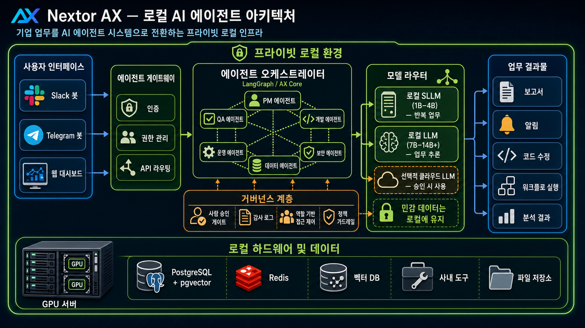

# AX Project

AX Project는 AI를 다양한 X 영역에 적용하고 연결하기 위한 프로젝트입니다. 현재 보유한 하드웨어와 시스템을 기반으로, 에이전트 프레임워크와 커스텀 AI 구성을 검토해 실사용 가능한 구조와 우선 적용 과제를 정의하는 것이 목적입니다.

그림 1. AX Project 개념도



AX Project는 다음과 같은 문제, 애플리케이션, 유즈케이스에 적용될 수 있습니다.

- 반복적인 업무 자동화
- 문서 요약 및 정보 추출
- 검색과 질의응답
- 데이터 조회 및 분석 보조
- 업무 흐름 지원 및 작업 분배
- 에이전트 기반 작업 수행
- 24시간 상시 실행되는 프로세스 및 워크플로우 처리
- 기존 시스템과 AI 연동

## 장점과 한계

### 장점

- 업무 효율 향상
- 반복 작업 감소
- 정보 접근 속도 개선
- 시스템 간 연결성 확대
- 다양한 유즈케이스로 확장 가능

### 한계

- 초기 설계와 정리가 필요함
- 데이터와 권한 관리가 중요함
- 잘못된 응답이나 자동화 오류 가능성 있음
- 시스템 복잡도가 높아질 수 있음
- 유지보수와 운영 기준이 필요함

## 현재 보유 자원

### GPU

- A6000 (40GB) x 3

메모: 향후 프로젝트, 애플리케이션, 유즈케이스에 따라 필요한 자원은 추가로 확보할 예정입니다.

## AI 사용용 자원

AX에서 먼저 필요한 영역은 로컬 LLM 실행, 에이전트 구동, RAG, 워크플로우 자동화 같은 AI 사용입니다. 이 목적에는 아래와 같은 하드웨어가 적합합니다.

### 권장 하드웨어

- MVP: RTX 4090 24GB + 128GB RAM
- 개선형 MVP: RTX 5090 32GB + 128GB 또는 256GB RAM
- 회사 파일럿: RTX 6000 Ada 48GB 또는 L40S 48GB
- 엔터프라이즈: RTX PRO 6000 Blackwell 96GB

### 권장 구성

- GPU: RTX 5090 32GB
- RAM: 128GB 이상, 가능하면 256GB
- CPU: Ryzen 9, Intel i9, 또는 Threadripper
- Storage: 4TB NVMe
- OS: Ubuntu
- Runtime: Ollama, vLLM

이 구성은 로컬 LLM, LangGraph 기반 에이전트, RAG, Slack/Telegram/Web UI, 24시간 상시 실행되는 로컬 AI 서버에 적합합니다.

## AI 학습 및 파인튜닝용 자원

AX에서는 처음부터 모델을 새로 학습하기보다, RAG와 도구 메모리, LoRA 파인튜닝을 중심으로 가는 것이 현실적입니다. 학습과 파인튜닝은 사용용 자원보다 더 많은 메모리와 안정적인 장비가 필요합니다.

### 권장 하드웨어

- Prompt tuning / RAG: 사용용과 동일한 하드웨어
- LoRA fine-tuning 7B: 24GB~32GB VRAM
- LoRA fine-tuning 14B: 32GB~48GB 이상 VRAM
- Fine-tuning 32B: 48GB~96GB 이상 VRAM
- Training from scratch: 멀티 GPU 클러스터 또는 클라우드 H100급 환경

### 권장 구성

- GPU: RTX PRO 6000 Blackwell 96GB 또는 RTX 6000 Ada 48GB
- RAM: 256GB
- Storage: 4TB~8TB NVMe
- OS: Ubuntu
- Frameworks: PyTorch, Transformers, PEFT, Axolotl 또는 Unsloth

### 참고 장비

- DGX Spark: 128GB unified memory 기반의 소형 AI 개발 장비

DGX Spark는 로컬 연구, 데모, 대형 모델 실험, 에이전트 프로토타입에 적합합니다. 다만 일상적인 AX 개발용 주력 장비는 RTX 5090 워크스테이션 쪽이 더 현실적입니다.

## AI Agents

AI agent는 LLM을 기반으로 추론하고, 도구를 사용하고, 상태를 기억하고, 외부 시스템에 작업을 수행하는 시스템입니다.  
Nextor AX에서 중요한 질문은 단순히 “어떤 에이전트가 좋은가”가 아니라, “어떤 구조가 신뢰 가능하고, 보안이 가능하며, 로컬 우선으로 운영 가능한가”입니다.

### Framework / SDK / ADK

#### Framework

에이전트 작업 흐름을 구성하는 구조입니다.

- 예: LangGraph, AutoGen, CrewAI, Semantic Kernel
- 용도: 멀티 에이전트, 상태 관리, 도구 호출, 워크플로우 제어, human approval, 장기 실행 작업
- 의미: 에이전트용 아키텍처 뼈대

#### SDK

특정 플랫폼이나 모델에 연결하기 위한 개발 도구 모음입니다.

- 예: OpenAI Agents SDK, model provider SDK
- 용도: tool calling, guardrails, handoff, structured output
- 의미: 특정 환경에서 에이전트를 만드는 개발 키트

#### ADK

에이전트 개발에 특화된 도구 모음입니다.

- 예: Google ADK
- 용도: agent creation, debugging, evaluation, deployment, multi-agent systems
- 의미: production agent를 위한 특수 도구 묶음

### 주요 분류

#### Orchestration Framework

에이전트가 함께 움직이는 방식을 제어합니다.

- LangGraph
- AutoGen
- CrewAI
- Semantic Kernel

적합한 경우:

- multi-agent workflows
- business process automation
- long-running tasks
- human-in-the-loop approval
- state tracking

#### Model Provider SDK

LLM 제공사의 기능을 직접 활용하는 방식입니다.

- OpenAI Agents SDK
- Gemini SDK / ADK
- Anthropic SDK
- Mistral SDK

적합한 경우:

- tool calling
- structured outputs
- function calling
- model-specific capabilities
- 빠른 연동

#### Enterprise ADK

운영과 배포를 고려한 production 중심 도구입니다.

- Google ADK
- Microsoft Agent Framework / Semantic Kernel 방향
- OpenAI Agents SDK with guardrails and handoffs

적합한 경우:

- enterprise deployment
- observability
- evaluation
- multi-agent control
- production debugging

#### Local Action Agent

로컬 머신이나 내부 도구에서 실제 작업을 수행하는 에이전트입니다.

- OpenClaw
- Hermes Agent
- OpenHands
- local coding agents

적합한 경우:

- file operations
- browser automation
- messaging integrations
- personal assistant style workflows

### 주요 연구 대상

| 도구 | 유형 | 적합한 용도 | AX 관점 |
| --- | --- | --- | --- |
| LangGraph | Orchestration framework | 상태 기반, 장기 실행, 제어된 에이전트 워크플로우 | 매우 강함 |
| LangChain | LLM app framework | 도구, RAG, 통합 | 보조 레이어로 유용 |
| Google ADK | Agent Development Kit | 기업용 multi-agent 시스템 | 강한 참고 대상 |
| OpenAI Agents SDK | SDK | tools, handoffs, guardrails, structured output | cloud/hybrid용 |
| Microsoft AutoGen | Multi-agent framework | 에이전트 협업과 실험 | 참고 가능하지만 방향 확인 필요 |
| Semantic Kernel | Enterprise orchestration SDK | Microsoft 생태계, planners, skills | MS 환경에서 유리 |
| CrewAI | Multi-agent framework | role-based agent team | 빠른 프로토타입용 |
| OpenHands SDK | Software agent SDK | coding agents, secure execution | 개발 에이전트 연구용 |
| OpenClaw | Local action agent | local automation | 참고 가능, enterprise는 guardrail 필요 |
| Hermes Agent | Self-hosted agent | memory, self-improving workflow | 연구용 후보 |

### 핵심 후보

#### LangGraph

AX에서 가장 중요한 후보입니다. 상태가 있는 장기 실행 에이전트와 제어된 워크플로우에 적합합니다.

- 장점: production workflow에 적합, state와 memory 지원, human-in-the-loop 구성 가능, multi-agent orchestration에 유리
- 단점: 구현 부담이 있음, 단순 데모보다 설계가 필요함

#### Google ADK

기업용 에이전트 개발과 배포를 위한 참고 기준입니다.

- 장점: enterprise-oriented, multi-agent support, debugging/deployment 방향이 명확함
- 단점: Google Cloud 방향으로 기울 수 있음, local-first MVP에는 과할 수 있음

#### OpenAI Agents SDK

도구 호출, handoff, guardrails, structured output에 강합니다.

- 장점: 구조가 깔끔함, tool calling이 좋음, cloud reasoning에 유리함
- 단점: cloud-first 성격이 강함, local-first와는 분리해서 봐야 함

#### AutoGen

멀티 에이전트 연구에서 의미가 있지만, 새 코어로 선택하기에는 적합하지 않습니다.

- 장점: 협업 패턴 참고 가능
- 단점: maintenance 방향 확인 필요, migration risk 존재

### Nextor AX 방향

AX는 하나의 도구에 전부 의존하기보다 역할을 나누는 구조가 더 적합합니다.

```text
User Interface
- Slack Bot
- Telegram Bot
- Web Dashboard

Agent API Gateway
- Auth
- Permissions
- Audit logs

Agent Orchestrator
- LangGraph
- Custom AX Core

Agent Layer
- PM Agent
- QA Agent
- Dev Agent
- Ops Agent
- Data Agent
- Security Agent

Model Router
- Local SLLM
- Local LLM
- Optional Cloud LLM

Tool Layer
- Files
- Database
- Git
- ERP/CRM
- Browser
- Company APIs
```

### 권장 스택

| Layer | Choice |
| --- | --- |
| Core orchestration | LangGraph |
| Tool/RAG support | LangChain |
| Local inference | Ollama first, vLLM later |
| Cloud escalation | OpenAI Agents SDK or Gemini API |
| Enterprise reference | Google ADK |
| Governance | Custom AX approval/audit layer |

### 결론

Nextor AX에서 중요한 것은 “가장 똑똑한 에이전트”가 아니라,  
`신뢰 가능하고, 승인 가능하고, local-first로 운영 가능한 business agent 구조`를 만드는 것입니다.

권장 방향은 다음과 같습니다.

> LangGraph를 core orchestrator로 두고,  
> AX 전용 governance layer를 얹고,  
> local model과 optional cloud model을 model router로 분리해서 지원한다.

이 방식은 다음을 동시에 만족합니다.

- local-first deployment
- lower token cost
- better data privacy
- human approval
- multi-agent teamwork
- less vendor lock-in

### 필요한 연구

- 어떤 업무와 유즈케이스를 먼저 적용할지 정리
- 어떤 애플리케이션과 워크플로우가 우선 대상인지 파악
- 사람이 반드시 검토해야 하는 지점과 자동화 가능한 지점을 구분
- 24/7 실행이 필요한 업무와 이벤트성 업무를 구분
- 파일럿에 적합한 사용 사례를 정리
- 각 사용 사례에 필요한 데이터와 시스템 연결 범위를 확인

### 권장 실행

1. 업무, 애플리케이션, 워크플로우 기준으로 우선순위를 정한다.
2. 효과가 큰 사용 사례를 먼저 파일럿 대상으로 본다.
3. 자동화 범위와 승인 범위를 구분한다.
4. 필요한 데이터와 시스템 연결 조건을 정리한다.
5. 기술 선택은 그 다음 단계에서 결정한다.
