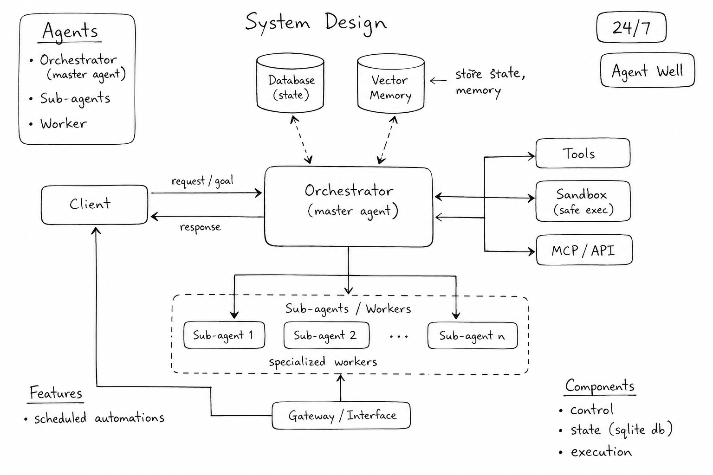

# AX Agent System Design Specification V1

## 1. Overview

AX Agent System은 중앙 Orchestrator를 중심으로 동작하는 멀티 에이전트(Multi-Agent) 플랫폼이다. 사용자의 요청을 분석하고 작업을 계획한 후, 적절한 Sub-Agent(Worker)에게 작업을 분배하여 실행한다.

시스템은 상태(State)와 메모리(Memory)를 지속적으로 관리하며, 내부 도구(Tools), Sandbox 환경, MCP 및 외부 API를 활용하여 복합적인 작업을 수행할 수 있다.

본 시스템은 확장성(Scalability), 모듈성(Modularity), 안전성(Security), 그리고 지속적인 자동화(Automation)를 목표로 설계되었다.

---

# 2. Architecture Overview

AX Agent System은 다음과 같은 세 개의 주요 계층으로 구성된다.

## Control Layer

전체 시스템의 의사결정과 실행 흐름을 담당한다.

### Components

* Orchestrator (Master Agent)
* Workflow Router
* Agent Registry

### Responsibilities

* 요청 분석
* 작업 계획 수립
* Agent 선택
* Workflow 결정
* 실행 제어
* 결과 통합

---

## State Layer

시스템 상태와 컨텍스트를 저장 및 관리한다.

### Components

* SQLite Database
* State Store
* Memory Store

### Responsibilities

* 상태 관리
* 컨텍스트 관리
* 실행 이력 저장
* 메모리 유지

---

## Execution Layer

실제 작업 수행을 담당한다.

### Components

* Sub-Agents
* Tools
* Sandbox
* MCP Servers
* External APIs

### Responsibilities

* 작업 실행
* 데이터 처리
* 코드 실행
* 외부 리소스 연동

---

# 3. Agent Components

## Orchestrator (Master Agent)

시스템의 중앙 제어 컴포넌트이다.

### Responsibilities

* 사용자 요청 분석
* Task Planning
* Workflow Routing
* Agent Selection
* Execution Coordination
* Result Aggregation

Orchestrator는 전체 시스템의 진입점이자 최종 의사결정 계층으로 동작한다.

---

## Sub-Agents (Workers)

특정 업무를 수행하는 전문 에이전트이다.

### Responsibilities

* 작업 실행
* 도구 활용
* 결과 생성
* 상태 업데이트

### Characteristics

* 독립 실행 가능
* 병렬 처리 지원
* 동적 생성 가능
* 역할 기반 구성 가능

---

## Memory & State (SQLite)

에이전트 상태와 작업 컨텍스트를 관리하는 저장 계층이다.

### Stores

* Session State
* Agent State
* Workflow State
* Execution History
* Memory Context

### Benefits

* 영속성 제공
* 재시작 복구 가능
* 컨텍스트 유지
* 낮은 운영 복잡도

---

## Skills (skill.md)

에이전트의 능력(Capability)과 행동 규칙을 정의하는 구성 요소이다.

### Responsibilities

* 역할 정의
* 행동 규칙 정의
* 도구 사용 규칙 정의
* 프롬프트 관리

### Examples

* Research Skill
* Coding Skill
* Planning Skill
* Analysis Skill

---

## Tools (AX Tools)

에이전트가 활용할 수 있는 내부 도구 집합이다.

### Responsibilities

* 검색
* 파일 처리
* 데이터 분석
* 코드 실행 지원
* 외부 시스템 호출

도구는 에이전트의 실행 능력을 확장하는 핵심 구성 요소이다.

---

## Sandbox

격리된 코드 실행 환경이다.

### Responsibilities

* 안전한 코드 실행
* 리소스 격리
* 프로세스 분리

### Characteristics

* RPC 기반 실행
* Host 시스템 보호
* 독립 실행 환경 제공

---

## MCP & External APIs

외부 시스템과 연동하기 위한 통합 계층이다.

### Responsibilities

* 외부 서비스 연결
* 데이터 조회
* 시스템 통합
* API 호출

### Examples

* MCP Servers
* SaaS Platforms
* Internal Services
* Third-Party APIs

---

# 4. Core Design Concepts

## Planning & Reasoning

모든 요청은 먼저 Orchestrator에서 분석된다.

### Process

1. Request Analysis
2. Goal Identification
3. Task Decomposition
4. Workflow Selection
5. Agent Assignment

이를 통해 복잡한 요청을 실행 가능한 작업 단위로 분해한다.

---

## Workflow Routing

작업의 특성에 따라 적절한 Workflow 또는 Agent로 라우팅한다.

### Routing Targets

* Sequence Workflow
* Loop Workflow
* Parallel Workflow
* Specialized Agent

---

## RPC-Based Agent Communication

에이전트 간 통신은 RPC 기반으로 수행된다.

### Benefits

* 느슨한 결합(Loose Coupling)
* 독립 실행
* 확장 용이성
* 낮은 컨텍스트 비용

---

## Zero Context Cost Architecture

Hermes Agent 구조를 기반으로 상태와 컨텍스트를 중앙 저장소에 관리한다.

### Benefits

* Context Window 절약
* 상태 공유 가능
* 실행 비용 감소
* 장기 작업 지원

---

## Batch & Parallel Execution

여러 작업을 동시에 처리할 수 있도록 설계되었다.

### Benefits

* 처리 속도 향상
* 리소스 활용 최적화
* 대규모 작업 지원

---

# 5. Workflow Types

## Sequence Agent

작업을 순차적으로 실행하는 Workflow이다.

### Use Cases

* 데이터 처리 파이프라인
* 단계별 분석 작업
* 승인 프로세스

### Flow

Task A → Task B → Task C

---

## Loop Agent

조건이 충족될 때까지 반복 실행하는 Workflow이다.

### Use Cases

* 반복 검증
* 품질 개선
* 목표 기반 작업

### Flow

Task → Evaluation → Retry

---

## Parallel Agent

독립적인 작업을 동시에 실행하는 Workflow이다.

### Use Cases

* 대규모 데이터 처리
* 다중 리서치 작업
* 병렬 분석

### Flow

Task A
Task B
Task C

→ Result Aggregation

---

# 6. Execution Flow

1. Client Request
2. Orchestrator Analysis
3. Planning & Reasoning
4. Workflow Selection
5. Agent Routing
6. Task Execution
7. Tool / MCP / API Access
8. State & Memory Update
9. Result Aggregation
10. Response Generation

---

# 7. Key Features

### Multi-Agent Architecture

전문화된 에이전트 기반 작업 수행

### Dynamic Agent Routing

작업 유형에 따른 동적 에이전트 선택

### SQLite-Based State Management

경량 영속 저장소 기반 상태 관리

### Skill-Based Agent Design

스킬 중심의 역할 정의

### RPC-Based Communication

에이전트 간 독립적 통신

### Isolated Sandbox Execution

안전한 코드 실행 환경 제공

### MCP & External Integration

외부 시스템과의 유연한 연동

### Parallel Processing Support

병렬 및 배치 작업 지원

### Workflow-Oriented Execution

Sequence, Loop, Parallel 기반 실행 모델

---

# 8. Design Goals

* 단순하고 확장 가능한 구조
* 낮은 운영 비용
* 안전한 코드 실행
* 높은 재사용성
* 에이전트 중심 아키텍처
* 장기 실행(Long-Running Tasks) 지원
* 24/7 자동화 운영 지원
* Hermes Agent와의 높은 호환성
