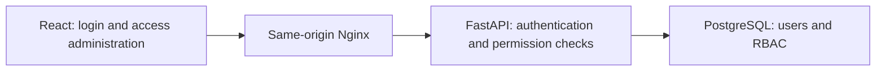

# Nexgent Login and Access Architecture

Date: 2026-09-17

Scope revision (2026-09-17): replaces the earlier company/identity-provider/workspace proposal with a simple, extensible model. Implementation and validation: [Unified app authentication](../08-implementation/unified-app-authentication.md).

## Scope

One company, Nexgent-managed accounts, username/password login. Administrators create accounts, reset passwords, disable accounts, and manage groups, roles, and permissions. No public registration.

There are no company, identity, principal, invitation, provisioning, application-session, workspace, resource, restriction, MFA, or delegation tables. Keycloak, Mailpit, SSO, email verification, invitation acceptance, and self-service recovery are outside this version.

## Components



Keep the existing FastAPI and React stack. An existing PostgreSQL database, configured only through `NEXGENT_DATABASE_URL`, owns both account credentials (Argon2id hashes only) and authorization assignments. SQLAlchemy models and Alembic migrations describe eight application tables in the `auth` schema. Alembic version tracking also lives in `auth`. Nginx serves the web app and proxies all feature/account API calls to the same backend; the backend host port is loopback-only. Authentication does not add a database service or provision a database/user; it connects to the supplied PostgreSQL URL.

No separate identity service is needed. Password hashing uses pwdlib/Argon2; signed login cookies use PyJWT. The cookie is HttpOnly, SameSite=Lax, and Secure with a `__Host-` name outside explicit loopback HTTP development. Its signed claims contain user ID, token version, issuer, audience, issued/expiry times and a random token ID. The default lifetime is eight hours, without refresh tokens.

Every authenticated request loads the active user, checks `token_version`, and reads current role/permission assignments. Password reset, disabling, and logout increment the version, invalidating all previous logins. There is no session registry or individual-device logout. Logout is labelled “Sign out all devices.”

## Authorization

```text
user → direct roles → permissions
user → groups → group roles → permissions
effective permissions = union of both paths
```

No group nesting, scoped roles, permission inheritance between roles, wildcard matching, or explicit-deny rules.

The built-in `Administrator` role grants `access.manage`. Every access-management endpoint requires that permission. Custom roles may also grant it, including through a group. This is full account/access administration; this version has no narrower delegated administrator.

Role names are labels; permission keys are what the backend enforces. Creating a custom permission key does not automatically protect or enable a feature. A feature must explicitly check its supported permission key when integrated. Client-side visibility is only presentation.

Administrators can edit/delete custom groups, roles and permissions. Built-in definitions are read-only. Users are disabled instead of deleted, keeping stable user IDs for future integrations.

All access mutations lock the built-in role row, recheck the actor's current authority and login version, and verify that at least one active account with a password retains `access.manage`. Failure rolls back the entire change. The lock serializes simultaneous edits across backend processes using PostgreSQL.

## Login and account creation

1. An operator creates the first administrator with an interactive CLI.
2. The administrator signs in and creates users with initial passwords.
3. The administrator assigns direct roles and/or groups.
4. Users sign in using those credentials.
5. Password recovery is an administrator reset; the CLI provides operator recovery.

Passwords are never included in API responses, query caches, browser storage, logs, or command-line arguments. UI password fields are uncontrolled and cleared on submission. Validation errors use generic codes rather than reflecting submitted inputs.

Mutations require the exact configured Origin. Authenticated mutations additionally require a CSRF token bound to the current cookie. Login is rate-limited by the supplied Nginx ingress. Any other public deployment must provide equivalent ingress protection and HTTPS.

## Deployment boundary

The standard `compose.yaml` and `compose.prod.yaml` deploy the same authenticated
app. The backend runs Alembic before Uvicorn starts. There is no separate account
stack or mode flag. Login at `/login` gates the normal frontend; Settings contains
account and access administration.

Chat, Nextcloud and RAG Chat routes require login. RAG, Scout, Scout scheduler,
Weekly Reporter and Agent Server browser requests pass through fixed backend
gateway routes with the same login/CSRF checks. Current feature access is shared
by all active signed-in users; only account administration requires `access.manage`.
The Agent Server is internal to Docker. Independently operated upstream services
must also be kept private; the gateway does not change their own authentication.

Native Tauri currently directs users to the authenticated browser application.

## Extension points

Add permission keys and enforce them as features are integrated. Add roles and group assignments without changing the schema. Add new tables only for demonstrated requirements; broader tenancy, delegation, and resource policy systems are not part of this implementation.

See the [detailed schema](../05-data/identity-access-database-plan.md) and [API/UI plan](../07-roadmap/identity-access-delivery-plan.md).
