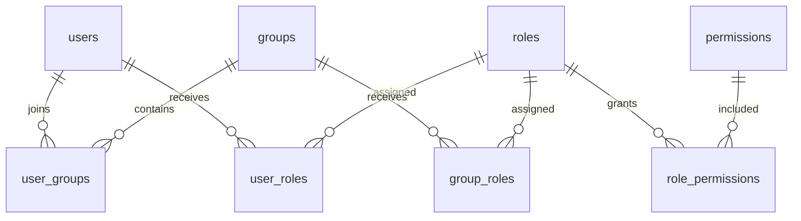

# Nexgent Login and Access Database Schema

Date: 2026-09-17

Password policy update (2026-09-21): creation and resets now require 4–12 characters; existing longer passwords remain valid for login. See [Password Length Policy](../08-implementation/password-length-policy.md).

Scope revision (2026-09-17): this is the current implemented eight-table schema, replacing the earlier broad proposal. The SQLAlchemy source and Alembic migration are authoritative.

- Models: [backend/app/identity/models.py](../../backend/app/identity/models.py)
- Account simplification migration: [20260917_02_simple_access.py](../../backend/migrations/versions/20260917_02_simple_access.py)
- Schema migration: [20260917_03_auth_schema.py](../../backend/migrations/versions/20260917_03_auth_schema.py)
- Operations and validation: [Unified app authentication](../08-implementation/unified-app-authentication.md)

PostgreSQL database: the existing database selected by `NEXGENT_DATABASE_URL`. There is no bundled database or default database URL. All eight application tables and `alembic_version` use the explicit `auth` schema. Runtime queries and foreign keys are schema-qualified; they do not depend on the connection search path. IDs are UUID strings stored as `VARCHAR(36)`. Timestamps use UTC `TIMESTAMP WITH TIME ZONE`. SQLite is also used for portable automated tests.

## Relationships



## auth.users

| Column | Type | Nullable | Rule / purpose |
| --- | --- | --- | --- |
| id | varchar(36) | no | Primary key; UUID generated by application |
| username | varchar(64) | no | Unique; login identifier |
| display_name | varchar(200) | no | Display name |
| email | varchar(320) | no | Optional contact text; empty string allowed; not a login identifier |
| password_hash | varchar(500) | yes | Argon2id hash; null only for imported users awaiting an admin password reset |
| is_active | boolean | no | Whether account can log in; default true |
| token_version | integer | no | Default 0; check >= 0; invalidates previously issued cookies when incremented |
| created_at | timestamptz | no | Account creation time |

The API/CLI trims and lowercases usernames. They must match `^[a-z0-9][a-z0-9._-]{2,63}$`. Usernames are immutable through the current admin API. New accounts require a 4–12 character password; the API never accepts a caller-provided password hash. Email is optional and is neither unique nor verified.

`is_active` and `token_version` have database defaults. UUIDs, creation timestamps, empty strings, and other creation defaults are set by the application. Use the API/CLI to create users.

## auth.groups

| Column | Type | Nullable | Rule / purpose |
| --- | --- | --- | --- |
| id | varchar(36) | no | Primary key |
| name | varchar(100) | no | Unique group name |
| description | varchar(500) | no | Optional text, empty string allowed |

A group is a flat collection of users. It grants the roles in `group_roles` to every member. No parent groups, organization records, or department-specific tables.

## auth.roles

| Column | Type | Nullable | Rule / purpose |
| --- | --- | --- | --- |
| id | varchar(36) | no | Primary key |
| name | varchar(100) | no | Unique role name |
| description | varchar(500) | no | Optional text |
| is_system | boolean | no | Application default false; built-in definitions cannot be edited/deleted via API |

A role is a named set of permissions. Users can receive multiple roles directly and through groups.

## auth.permissions

| Column | Type | Nullable | Rule / purpose |
| --- | --- | --- | --- |
| id | varchar(36) | no | Primary key |
| key | varchar(100) | no | Unique backend permission key |
| description | varchar(500) | no | Optional text |
| is_system | boolean | no | Application default false; protects built-in definitions |

API key format: `^[a-z][a-z0-9_.:-]{1,99}$`; example: `tasks.read`. Keys have exact-match semantics. The only currently enforced key is `access.manage`; feature-specific keys require corresponding backend enforcement.

Group names, role names, and permission keys use case-sensitive database uniqueness. The API trims names and restricts permission keys to lowercase.

## Assignment tables (all in auth)

| Table | Composite primary key | Foreign keys |
| --- | --- | --- |
| user_groups | (user_id, group_id) | users.id, groups.id |
| user_roles | (user_id, role_id) | users.id, roles.id |
| group_roles | (group_id, role_id) | groups.id, roles.id |
| role_permissions | (role_id, permission_id) | roles.id, permissions.id |

Both columns in every assignment are non-null `varchar(36)`. Every foreign key has `ON DELETE CASCADE`. The primary key prevents duplicate assignments and indexes the left column; an additional index covers the right column.

Deleting a custom group, role, or permission removes its assignments. Such a deletion is rejected if it removes the last usable administrator. Users have no delete endpoint; disable them instead.

No direct user-to-permission assignment is needed. Effective permissions are the distinct union of permissions granted by direct roles and group roles.

## Seed data and invariants

| Entity | Stable ID | Value |
| --- | --- | --- |
| Built-in role | 00000000-0000-0000-0000-000000000001 | Administrator |
| Built-in permission | 00000000-0000-0000-0000-000000000002 | access.manage |

The migration connects these records through `role_permissions`; it does not create a user or default password.

`access.manage` permits all user/group/role/permission administration. Every mutation checks authorization on the server and serializes the last-admin check with a row lock on the built-in role. At least one active user with a non-null password hash must retain the permission after every successful change.

These policy checks are application rules, not database triggers. Direct SQL modifications bypass them; normal operations should use the API or operator CLI.

## Migration from the earlier foundation

Revision `20260917_01` remains as historical migration input. Revision `20260917_02`:

1. Preserves existing user IDs, display names, emails, and creation times.
2. Assigns deterministic usernames: `user-` plus the user's UUID with hyphens removed.
3. Copies suspended membership state into `users.is_active = false`.
4. Converts earlier owner memberships to the Administrator role.
5. Leaves imported password hashes null: external identity passwords cannot be copied.
6. Creates the new RBAC tables and drops `companies`, `identities`, `memberships`, `app_sessions`, `login_transactions`, and `audit_events`.

Other removed concepts were proposals and never had live tables in revision 01. The final schema contains only these eight application tables plus Alembic's `alembic_version` bookkeeping table.

Back up existing data before upgrading. Removed identity/session/audit records are not recoverable through downgrade; restore the pre-migration backup to roll back. All old login cookies become unusable.

A migrated owner can be recovered using the operator `set-password` command, or an operator can create a new administrator and reset imported accounts in the UI. Imported inactive users also need activation by an administrator.

## Auth schema update — 2026-09-17

Revision `20260917_03` moves existing revision-02 account tables from `public` to `auth`, preserving rows, passwords, IDs, constraints, indexes and assignments. The migration runner also moves the historical Alembic version table into `auth`. A revision-01 database first completes the account simplification and then moves its resulting tables. New databases create everything directly in `auth`. See [Auth database schema](../08-implementation/auth-database-schema.md) for migration history and [Unified app authentication](../08-implementation/unified-app-authentication.md) for current operations.

## Inspect or export the schema

From `backend/`, with `NEXGENT_DATABASE_URL` configured:

```bash
uv run alembic current
uv run alembic upgrade head --sql > /tmp/nexgent-auth-schema.sql
```

The SQL export creates `auth`, runs historical create/drop steps with its migration search path set, then records the final schema revision. Fresh installations never create account tables in `public`. To inspect the configured database, use `psql` with the same connection values. PostgreSQL CLI tools use `postgresql://` rather than SQLAlchemy’s `postgresql+psycopg://`:

```bash
psql "${NEXGENT_DATABASE_URL/postgresql+psycopg:/postgresql:}"
```

Inside psql:

```text
\dt auth.*
\d auth.users
\d auth.groups
\d auth.roles
\d auth.permissions
\d auth.user_groups
\d auth.user_roles
\d auth.group_roles
\d auth.role_permissions
```
