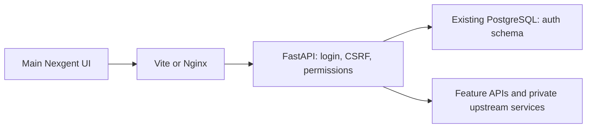

# Unified App Authentication

Date: 2026-09-17

LAN login update (2026-09-21): `backend/dev.env` now sets
`NEXGENT_PUBLIC_URL=http://192.168.0.18:5173` to match the development browser
origin. The previous localhost setting rejected LAN login requests with HTTP 403
`origin_not_allowed` before checking credentials. Exact-origin checks remain
enabled; use the configured LAN URL for development login. HTTP development is
already enabled through `NEXGENT_ALLOW_INSECURE_HTTP=true`. No account recreation
or database migration is needed. After an environment-file edit, recreate the
backend (a restart alone does not reload Compose environment values):

```bash
sudo docker compose up -d --no-deps --force-recreate backend
```

Validation: the configured localhost origin and the middleware's exact-origin
comparison were inspected, and the development environment file was updated.
Container recreation could not run because `sudo -n` requires interactive
authentication on this host; run the command above in an operator terminal.
Full credential validation requires the existing administrator's password; after
recreation, run `python3 backend/smoke_auth.py --origin http://192.168.0.18:5173 --login`
to check login and logout (this invalidates that administrator's existing logins).

Update: 2026-09-21 — Both Compose backends now join the existing external
`nexgent-rag_default` network. Local database URLs use
`nexgent-rag-postgres-1:5432`; see [Backend PostgreSQL Docker Network](backend-postgresql-docker-network.md)
for the startup failure, correction, and remaining runtime verification.

Nexgent now has one authenticated application. The existing `compose.yaml` and `compose.prod.yaml` remain the development and production entry points. The separate account Compose file and `legacy`/`managed` switches have been removed.

## Implemented behavior

- The main React app is wrapped by [AuthGate](../../frontend/src/features/accounts/AuthGate.tsx). Signed-out users see `/login`; successful login restores the requested feature URL.
- Chat, Agents, Nextcloud, RAG and Settings render only after `/api/me` confirms a login. Account administration is part of Settings, using the existing users/groups/roles/permissions UI.
- [The backend](../../backend/app/main.py) always mounts authentication and feature routes together. Only login and health are public; other API requests need a valid active account. Mutations also require the configured Origin and a cookie-bound CSRF token.
- Missing database/auth configuration fails startup; there is no unauthenticated application mode or account-database fallback.
- The standard backend [entrypoint](../../backend/start.sh) runs `alembic upgrade head` before starting Uvicorn. No separate migration service is needed. PostgreSQL migrations use a transaction-scoped advisory lock to serialize simultaneous starts against the same database.
- Login cookies are named per public origin so development and production on different ports do not overwrite each other's cookies. Existing logins need to sign in again after this cookie-name change.
- The [authenticated fetch adapter](../../frontend/src/shared/api/authenticatedFetch.ts) uses same-origin cookies and CSRF for feature calls, rejects cross-origin targets, and signals the UI on a 401. Logout/account changes clear feature query caches, chat state and agent-run state.
- Backend authentication dependencies can be reused by future features. All currently signed-in users share feature access; `access.manage` additionally controls account/group/role/permission administration.

There are still eight account tables in the `auth` schema. This integration adds no company, workspace, resource, session or delegation tables.

## One request boundary



The frontend no longer connects directly to backend/upstream host ports. Vite and Nginx forward all feature/API prefixes to the same backend, preserving the browser Origin. Production Nginx retains login rate limiting and supports streaming/uploads.

| Browser prefix | Backend destination |
| --- | --- |
| `/auth`, `/api/admin`, `/api/me` | Account routes |
| `/api/chat`, `/api/rag/chat`, `/api/nextcloud` | Existing FastAPI feature routes |
| `/agent-server` | `AX_AGENT_SERVER_URL` |
| `/weekly-report-bulk-api` | `AX_WEEKLY_REPORT_BULK_URL` |
| `/scout-api` | `AX_SCOUT_URL` |
| `/scout-scheduler-api` | `AX_SCOUT_SCHEDULER_URL` |
| `/rag-api` | `AX_RAG_SERVER_URL` |

The [feature gateway](../../backend/app/integrations.py) uses fixed server-configured destinations and preserves request paths/query parameters. It forwards uploads and streamed downloads/SSE. Browser cookies, Authorization and CSRF headers are not sent upstream; upstream cookies/CORS headers are not returned to the browser. Redirects and upstream 401s become integration errors rather than exposing an unprotected destination or falsely expiring the Nexgent login.

The Agent Server no longer publishes a host port. FastAPI's published host port is loopback-only for host diagnostics. The frontend is the browser entry point. Existing reporting services/storage remain in the standard stack; no new account database service is introduced.

## Environment files

Use the existing backend configuration location:

- Development: `backend/dev.env`
- Production: `backend/prod.env`

The configured authentication values from the old `infra/identity/.env` were copied into these ignored files without printing them or replacing existing values. The old ignored file is retained as an unused local copy; no Compose service or setup helper loads it. `ACCOUNT_SIGNING_KEY` is now named `NEXGENT_AUTH_SIGNING_KEY` in the backend files.

Required values:

```dotenv
NEXGENT_DATABASE_URL=postgresql+psycopg://USER:PASSWORD@DB_HOST:5432/DB_NAME
NEXGENT_PUBLIC_URL=http://localhost:5173
NEXGENT_AUTH_SIGNING_KEY=<generated random key>
# Explicit opt-in for HTTP development. Use HTTPS and false for a public deployment.
NEXGENT_ALLOW_INSECURE_HTTP=true
```

`NEXGENT_DATABASE_URL` remains the only account-database setting. The database/user must already exist. The configured role needs rights to create/use the `auth` schema and apply migrations. No server, database or database role is provisioned by Nexgent.

`NEXGENT_PUBLIC_URL` must exactly match the URL used in the browser. For LAN development, for example, set `http://192.168.0.18:5173`; for the stable local stack use its port, normally `5174`. Changing published frontend ports also requires updating this origin.

A host-local database exposed only on `127.0.0.1:5433` is not accessible at that address from the backend container. The backend now joins the existing `nexgent-rag_default` network and connects to `nexgent-rag-postgres-1:5432`. The database's host publication is unchanged. The `host.docker.internal` host-gateway alias does not make a loopback-only listener reachable.

Server-side upstream URLs are listed in [backend/example.env](../../backend/example.env). Compose supplies internal addresses for its Agent Server, Scout and Weekly Reporter services. RAG and the Scout scheduler remain separately operated services; defaults use the host gateway. Update `AX_RAG_SERVER_URL` / `AX_SCOUT_SCHEDULER_URL` if their deployment differs. Browser `VITE_*` upstream URL overrides no longer select direct connections.

## Start development

For a new installation only, copy `backend/example.env` to `backend/dev.env`, then edit the required values. Preserve an existing environment file. Generate a missing signing key:

```bash
python3 backend/setup_env.py
docker compose up --build -d
docker compose exec backend python -m app.identity.admin create-admin --username admin --name "Administrator"
```

The CLI prompts privately for the initial password. Skip account creation if that username already exists. Open http://localhost:5173 (or the exact configured public origin), sign in, and use **Settings** to create accounts and manage access.

Password recovery:

```bash
docker compose exec backend python -m app.identity.admin set-password --username admin
```

## Start production

Configure `backend/prod.env` with the production browser origin and the intended existing database. Generate a missing signing key and start the normal production stack:

```bash
python3 backend/setup_env.py --env-file prod.env
docker compose -f compose.prod.yaml up --build -d
docker compose -f compose.prod.yaml exec backend python -m app.identity.admin create-admin --username admin --name "Administrator"
```

The normal local frontend port is 5174. Use the account-creation command only when the initial admin does not already exist in the selected database.

Back up an existing account database before upgrading. Revision `20260917_03` remains the current schema head. Existing earlier public-schema installations follow the documented data-preserving schema move; the earlier identity-provider simplification still requires local password resets for imported accounts.

## Add future features

1. Add the React feature to the existing App/navigation. The login gate already protects rendering.
2. Add a FastAPI route to the existing application. The account middleware already requires login and CSRF for mutations.
3. Use `authenticatedFetch` in its API adapter. No new frontend server address is needed.
4. When a feature needs narrower access, enforce its exact permission key with the shared dependency:

```python
from fastapi import Depends
from app.identity.router import require_permission

@router.post("/example/run", dependencies=[Depends(require_permission("example.run"))])
def run_example():
    ...
```

Create/assign the matching permission through roles in Settings. A permission record alone does not enforce access. Existing feature routes currently require login only; there is no per-user resource ownership or tenant isolation in this version.

## Validation performed

- Full backend suite: **93 passed, 2 skipped**. The skips require PostgreSQL schemas/row locks.
- PostgreSQL 18.6 account suite: **46 passed**, including migration/schema comparison, data-preserving upgrades, live permission checks, concurrent last-admin protection and real-login access to feature routes.
- Gateway tests cover all five destinations, rejected unsigned/CSRF-free requests, streamed request/response bytes, downloads, private-header stripping, redirects and upstream errors.
- Frontend suite: **268 passed** across 26 files. Login-gate rendering, Settings admin visibility, same-origin routing, CSRF and existing feature adapters are covered.
- TypeScript/Vite build passed; the existing large-chunk advisory remains.
- Rust `cargo check` passed using the existing isolated target directory.
- `npm audit --audit-level=moderate`: **0 vulnerabilities**.
- Both standard Compose files resolve successfully. Checks confirm a single backend, no separate account/migration service, no published Agent Server port, loopback-only backend ports and no auth-mode build arguments.
- The environment helper generates missing/blank keys with mode 0600, preserves the database URL and an existing key, and is safe to rerun. Shell entrypoint syntax and `git diff --check` pass.
- Backend tests still emit existing FastAPI/Python 3.14 deprecation warnings.

Commands:

```bash
cd backend
.venv/bin/python -m pytest -q
NEXGENT_TEST_DATABASE_URL='postgresql+psycopg:///postgres?host=/tmp/nexgent-simple-auth-pg&port=55439' .venv/bin/python -m pytest tests/identity -q
```

The PostgreSQL test fixture creates/drops only temporary test databases on a private cluster with no TCP listener. The validation cluster was stopped afterward; use an equivalent dedicated test cluster to rerun.

From `frontend/`:

```bash
npm test
npm run build
CARGO_TARGET_DIR=/tmp/nexgent-identity-cargo-target cargo check --offline --manifest-path src-tauri/Cargo.toml
npm audit --audit-level=moderate
```

## Remaining deployment checks and limits

Docker access is still unavailable to the current OS account. No running deployment or user database was changed. Actual container startup, Nginx runtime behavior, the user's database connection and an interactive browser feature flow remain unverified.

Once database networking and the exact browser origin are configured, run:

```bash
docker compose up --build -d
docker compose ps
docker compose exec backend alembic current
python3 backend/smoke_auth.py --origin http://localhost:5173 --login
```

For production use `-f compose.prod.yaml` and pass its browser origin to the smoke script. The script checks signed-out feature rejection, admin login/catalog and logout; it invalidates that administrator’s existing logins. Environments sharing the same account database are affected too.

In the browser, verify deep-link login, Chat streaming/file uploads, Nextcloud previews/downloads, RAG operations, Scout runs/schedules, Weekly Reporter submission/export and Settings administration. Test a second user after logout to confirm no previous-user feature state is displayed.

The gateway protects Nexgent's exposed API. Independently operated RAG/Scout-scheduler servers must remain private to trusted backend/service callers; this change does not add authentication to those services themselves. Long-running requests already authorized at their start are not interrupted by later logout/revocation. Development Vite does not provide the production Nginx login rate limit; it is a development server.

Native Tauri login remains unimplemented and now shows the browser-use message instead of mounting an unauthenticated app. No native capabilities or CSP changes were added.
